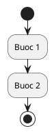

# Mẫu tài liệu tính năng

Mỗi tính năng của ứng dụng Android phải có **một** file `.md` trong thư mục
`docs/`, đặt tên bằng tiếng Việt không dấu theo tên tính năng.

Tạo file mới từ mẫu này và điền đủ 6 mục bên dưới.

---

```markdown
# <Tên tính năng>

> Hạng mục trong plan: P<n> — <tên hạng mục>
> Ngày hoàn thành: YYYY-MM-DD
> Trạng thái: Đã hoàn thành

## 1. Mục đích

Mô tả ngắn gọn tính năng này giải quyết việc gì, ai dùng, dùng ở bước nào
trong nghiệp vụ.

## 2. Luồng hoạt động

Sơ đồ các bước theo thứ tự thực thi.

```text
Bước 1 → Bước 2 → Bước 3
```

hoặc dùng PlantUML:



### 2.1. Các nhánh xử lý lỗi

| Tình huống | Mã lỗi | Xử lý |
|---|---|---|
| Token hết hạn | 401 UNAUTHORIZED | Xoá token, về màn hình đăng nhập |
| Không đủ tồn kho | 409 STOCK_CONFLICT | Hiện thông báo, cho kiểm tra lại |
| Mất mạng | IOException | Hiện thông báo mất mạng, cho thử lại |

## 3. Các file liên quan

| Loại | Đường dẫn | Vai trò |
|---|---|---|
| Activity | `app/src/main/java/.../ManHinhXxx.kt` | Màn hình chính |
| Layout | `app/src/main/res/layout/xxx.xml` | Giao diện |
| Adapter | `app/src/main/java/.../TrinhBayXxx.kt` | Hiển thị danh sách |
| Model | `app/src/main/java/.../du_lieu/DoiTuongXxx.kt` | Cấu trúc dữ liệu |
| Dịch vụ | `app/src/main/java/.../du_lieu/DichVuXxx.kt` | Gọi API, xử lý lỗi |
| Hằng số | `app/src/main/res/values/strings.xml` | Chuỗi hiển thị |

## 4. Bảng database liên quan

| Bảng | Trường dùng | Ghi chú |
|---|---|---|
| `products` | `id`, `name`, `stock`, `minStock` | ... |

## 5. Endpoint API được dùng

| Method | Đường dẫn | Mục đích |
|---|---|---|
| GET | `/api/v1/xxx` | ... |

## 6. Đối chiếu với Web

| Chức năng | Vị trí trên Web | Có trên mobile? |
|---|---|---|
| ... | `/sales` | ✅ |
```
