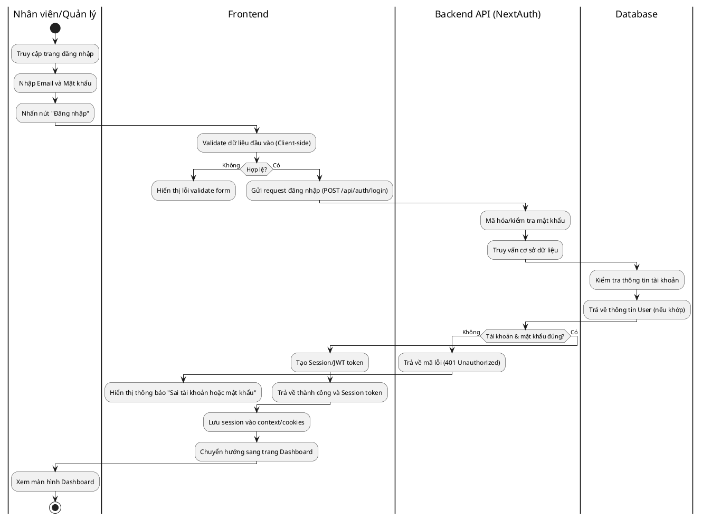
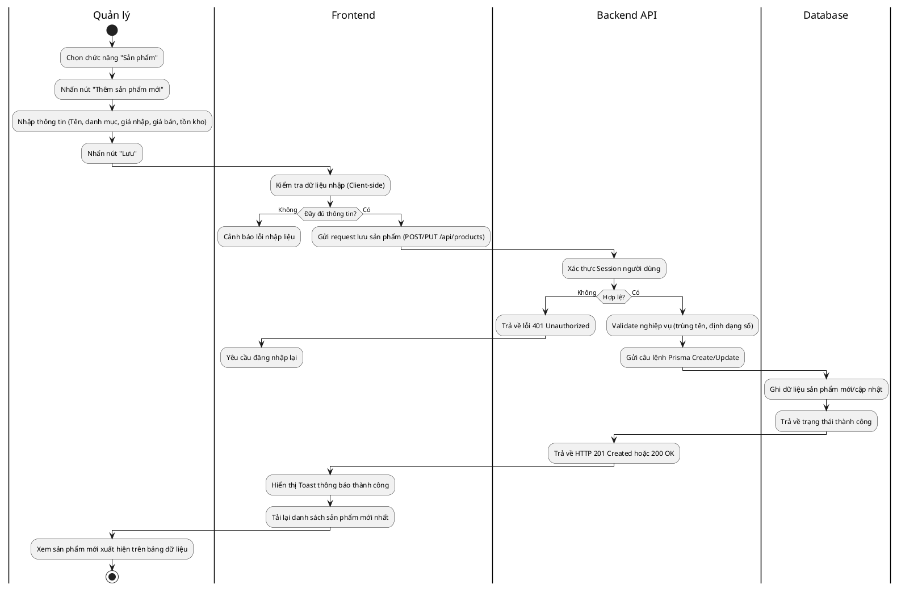
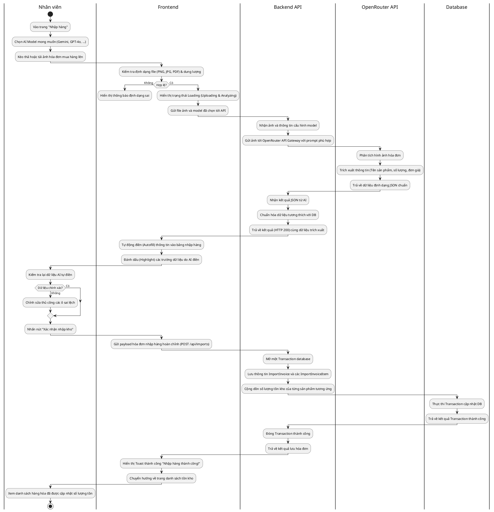
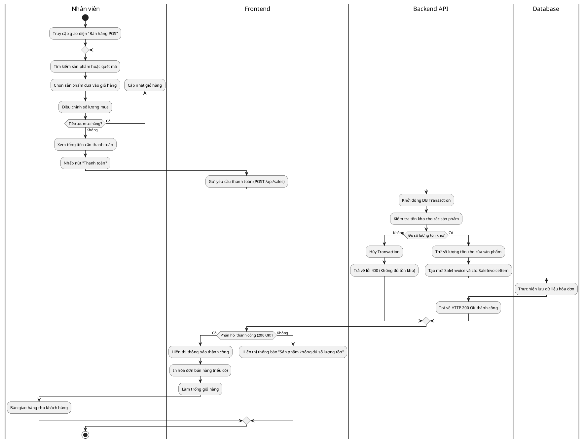
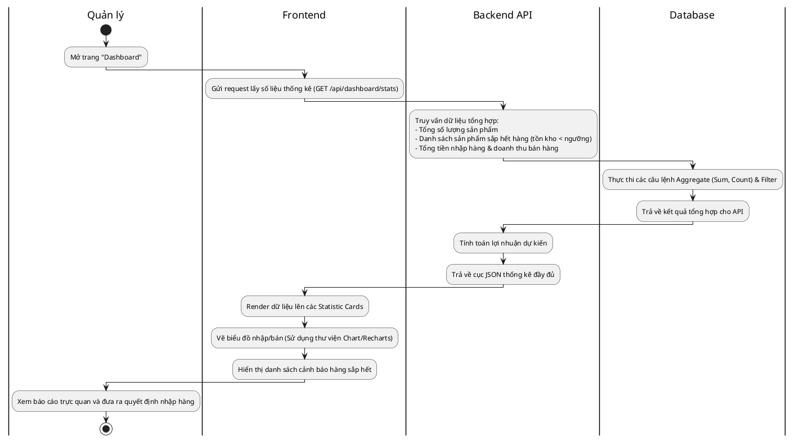

# Sơ đồ hoạt động (Activity Diagrams) với Swimlanes

Tài liệu này tổng hợp các sơ đồ hoạt động dạng **Swimlane** bằng ngôn ngữ **PlantUML** cho các chức năng chính của hệ thống Quản lý cửa hàng tạp hóa tích hợp AI OCR.

---

## 1. Chức năng Đăng nhập (Authentication)

Sơ đồ thể hiện luồng đăng nhập vào hệ thống của nhân viên hoặc quản lý.

---

## 2. Chức năng Quản lý Sản phẩm (CRUD Product)

Sơ đồ thể hiện luồng thêm mới/cập nhật sản phẩm.

---

## 3. Chức năng Nhập hàng bằng AI OCR (Tính năng cốt lõi)

Sơ đồ thể hiện luồng tải hóa đơn giấy lên, AI tự động nhận diện và hoàn tất hóa đơn nhập kho.

---

## 4. Chức năng Bán hàng tại quầy (POS Sale)

Sơ đồ thể hiện luồng chọn sản phẩm, tính tiền, và trừ kho tự động khi tạo hóa đơn bán.

---

## 5. Chức năng Dashboard Quản lý tồn kho & Báo cáo

Sơ đồ thể hiện luồng lấy dữ liệu thống kê tổng quan của cửa hàng.

