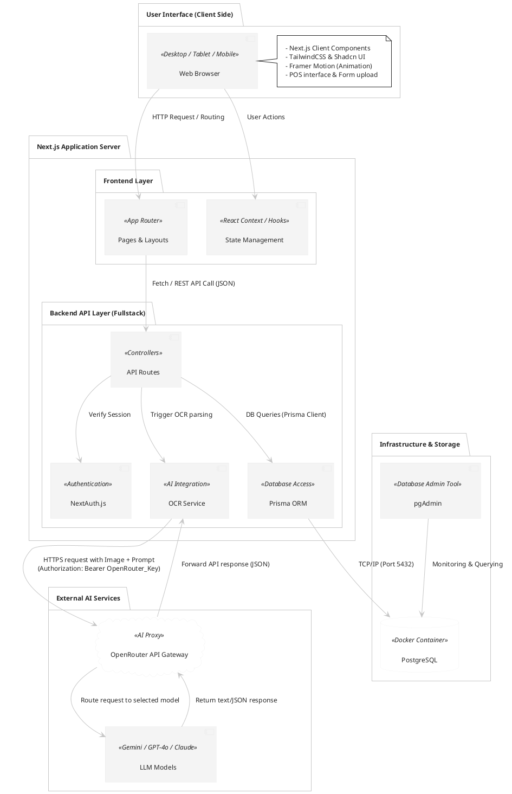

# Sơ đồ kiến trúc hệ thống (System Architecture Diagram)

Tài liệu này mô tả kiến trúc tổng thể của hệ thống Quản lý cửa hàng tạp hóa tích hợp AI OCR sử dụng **OpenRouter** làm cổng kết nối AI.

---

## Sơ đồ kiến trúc (PlantUML Component Diagram)

Dưới đây là sơ đồ kiến trúc các tầng của ứng dụng, từ Client, qua máy chủ Next.js Fullstack, đến Cơ sở dữ liệu và Dịch vụ AI ngoài (OpenRouter).

---

## Giải thích chi tiết các thành phần:

1. **User Interface (Tầng giao diện):**
   * Người dùng thao tác trên trình duyệt (máy tính, máy tính bảng hoặc điện thoại).
   * Giao diện được tối ưu hóa bằng **TailwindCSS** và **Shadcn UI** đem lại trải nghiệm Modern Dashboard & POS mượt mà.

2. **Next.js Application Server (Máy chủ ứng dụng):**
   * Đóng vai trò máy chủ Fullstack chạy trên Node.js runtime.
   * **Frontend Layer:** Đảm nhận Server-side rendering (SSR) và Client-side rendering (CSR) thông qua cơ chế App Router mới nhất của Next.js 15.
   * **Backend API Layer:** 
     * **NextAuth.js:** Xác thực phiên làm việc (Session) của người dùng.
     * **API Routes:** Các endpoint REST API nhận request từ client, thực thi nghiệp vụ bán hàng, quản lý sản phẩm.
     * **OCR Service:** Module chuyên trách tải tệp hóa đơn lên và giao tiếp với cổng **OpenRouter**.
     * **Prisma ORM:** Lớp ánh xạ đối tượng để giao tiếp an toàn, nhanh chóng với cơ sở dữ liệu mà không cần viết SQL thuần.

3. **Infrastructure & Storage (Tầng hạ tầng & Lưu trữ):**
   * Được container hóa bằng **Docker Compose** bao gồm:
     * **PostgreSQL:** Lưu trữ dữ liệu về sản phẩm, danh mục, hóa đơn bán (SaleInvoice) và hóa đơn nhập (ImportInvoice).
     * **pgAdmin:** Giao diện trực quan giúp quản trị viên dễ dàng quản lý DB trong quá trình phát triển.

4. **External AI Services (Tầng dịch vụ AI ngoại vi):**
   * Hệ thống không gọi trực tiếp riêng lẻ từng API của OpenAI hay Google, mà đi qua **OpenRouter API Gateway**.
   * **Ưu điểm khi dùng OpenRouter:**
     * Chỉ cần cấu hình duy nhất một API Key và Endpoint của OpenRouter.
     * Cho phép cấu hình linh hoạt để đổi model (ví dụ: chuyển từ `google/gemini-2.5-flash` sang `openai/gpt-4o-mini` hoặc `anthropic/claude-3.5-sonnet`) chỉ bằng cách thay đổi tên model gửi đi trong request mà không cần sửa lại code kết nối của ứng dụng.
