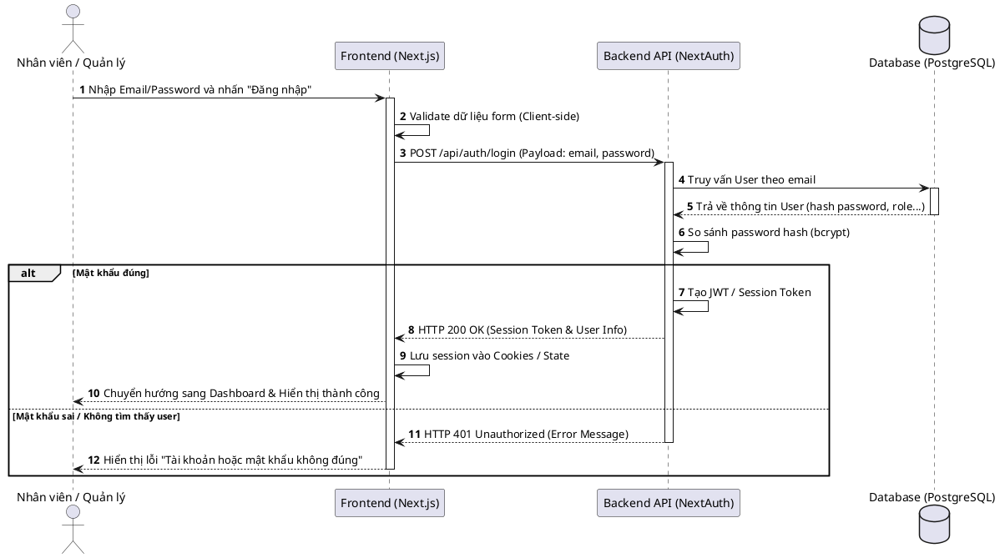
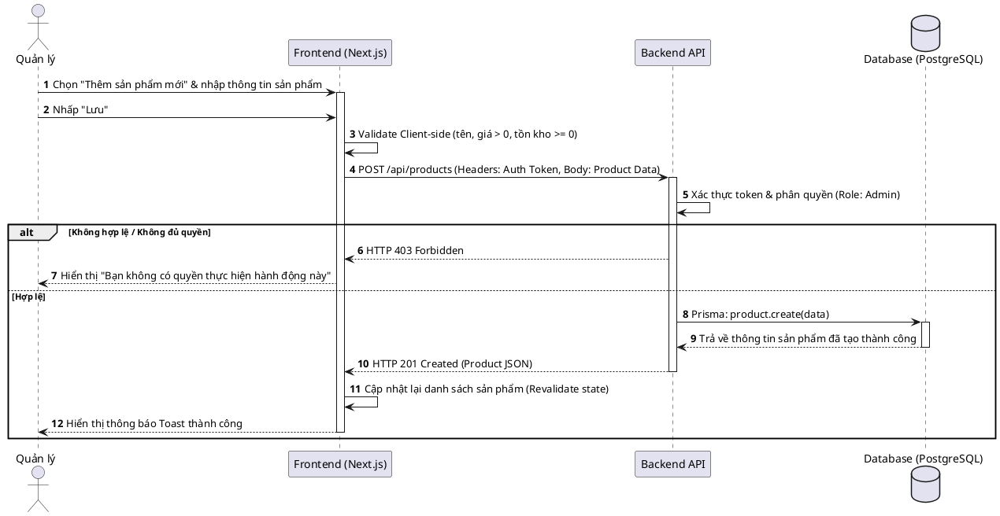
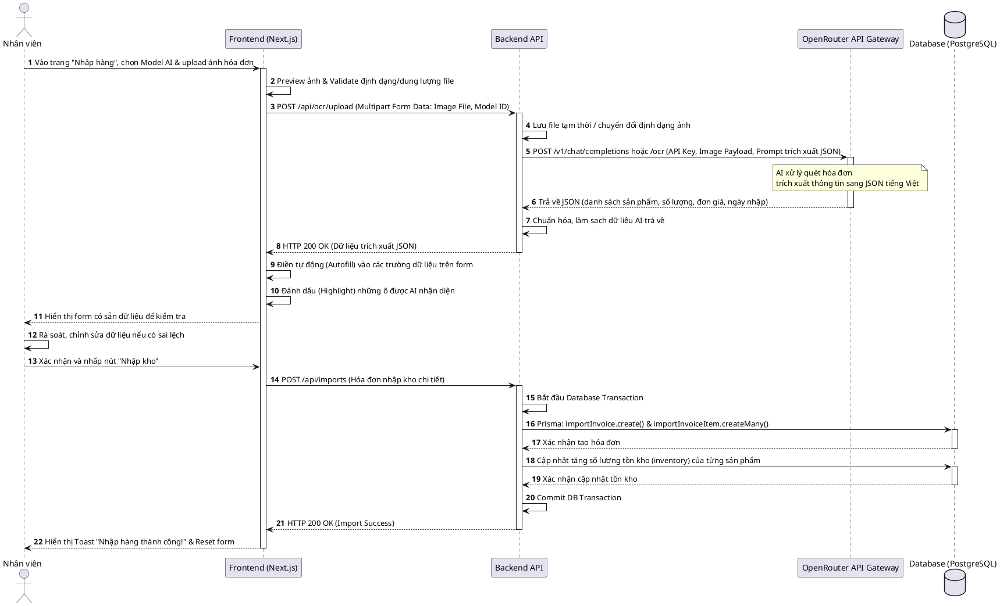
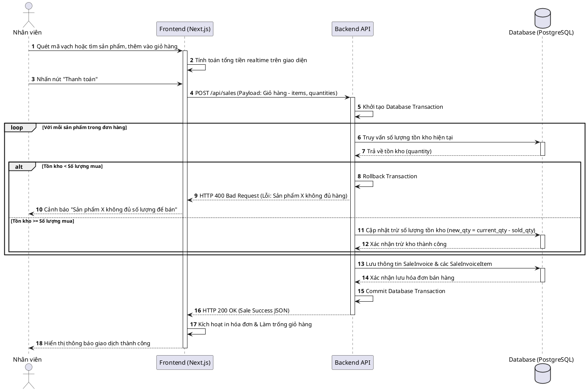
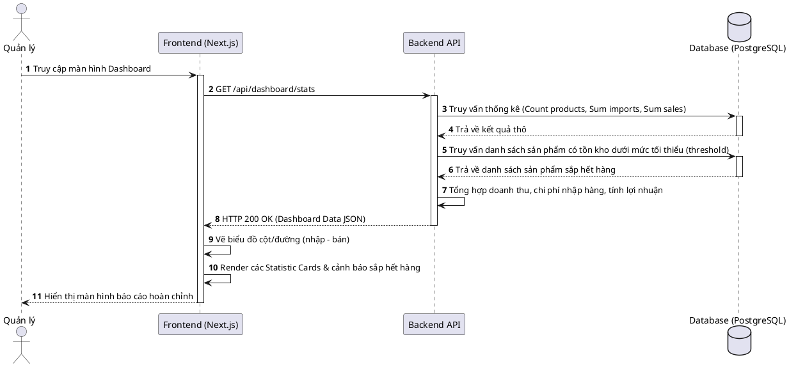

# Sơ đồ trình tự (Sequence Diagrams)

Tài liệu này tổng hợp các sơ đồ trình tự (Sequence Diagrams) mô tả chi tiết tương tác giữa các thành phần (Actor, Frontend, Backend, AI Service, Database) cho các tính năng chính của hệ thống.

---

## 1. Chức năng Đăng nhập (Authentication)

---

## 2. Chức năng Quản lý Sản phẩm (Create Product)

---

## 3. Chức năng Nhập hàng bằng AI OCR (Tính năng cốt lõi)

---

## 4. Chức năng Bán hàng tại quầy (POS Sale & Trừ kho)

---

## 5. Chức năng Dashboard Quản lý tồn kho & Báo cáo

