# Tong hop chuc nang he thong Store Manager

Tai lieu nay duoc tong hop sau khi doi chieu schema, giao dien `src/app`, middleware, `next-auth` va cac API route hien co trong du an.

## Pham vi kiem tra

- Giao dien nguoi dung va cac trang App Router
- API nghiep vu va cac quy tac xu ly du lieu
- Luong dang nhap va bao ve route
- Cac tinh nang da hoan thien, dang hoat dong mot phan, hoac moi dung o muc demo

## Bang tom tat chuc nang

| Chuc nang | Trang/API lien quan | Trang thai |
|---|---|---|
| Dang nhap va bao ve he thong | `/login`, `middleware.ts`, `lib/auth.ts` | Hoat dong |
| Dashboard tong quan | `/`, `/api/analytics/dashboard`, `/api/analytics/top-products` | Hoat dong |
| Quan ly danh muc | `/categories`, `/api/categories*` | Hoat dong |
| Quan ly san pham | `/products`, `/api/products*` | Hoat dong |
| Quan ly don vi tinh | `/units`, `/api/units*` | Hoat dong |
| Quan ly don vi theo san pham | `/products/[id]/units`, `/api/product-units` | Hoat dong |
| Quan ly nha cung cap | `/suppliers`, `/api/suppliers*` | Hoat dong |
| Quan ly khach hang | `/api/customers` | API co san, chua thay giao dien rieng |
| Nhap hang thu cong | `/import`, `/api/imports*` | Hoat dong |
| OCR hoa don nhap | `/import`, `/ai-ocr`, `/api/ocr/*` | Hoat dong, phu thuoc OpenRouter |
| Lich su va chi tiet phieu nhap | `/import/history`, `/import/[id]` | Hoat dong |
| Ban hang POS | `/sales`, `/api/sales*` | Hoat dong |
| Quan ly ton kho | `/inventory`, `/api/products` | Hoat dong |
| Thong ke doanh thu | `/revenue`, `/api/analytics/revenue*` | Hoat dong |
| Tao du lieu doanh thu mau | `/api/analytics/seed-test-data` | Ho tro demo |
| Cai dat he thong | `/settings` | Chu yeu la UI demo, chua thay luu DB |

## 1. Dang nhap va bao ve he thong

Mo ta:

- Nguoi dung dang nhap bang email va mat khau qua `next-auth` Credentials Provider.
- Mat khau duoc doi chieu bang `bcrypt`.
- Toan bo route giao dien, tru `/login`, deu bi middleware yeu cau xac thuc.
- Session JWT luu them `id` va `role`.

PlantUML:

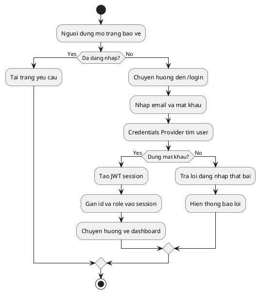

## 2. Dashboard tong quan

Mo ta:

- Hien so luong san pham, san pham sap het, tong phieu nhap, tong hoa don ban.
- Tinh tong tien nhap, tong tien ban va loi nhuan uoc tinh.
- Gom hoat dong gan day tu phieu nhap, hoa don ban va canh bao ton thap.
- Hien top san pham ban chay.

PlantUML:

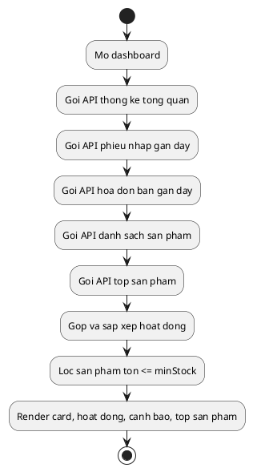

## 3. Quan ly danh muc

Mo ta:

- Xem danh sach danh muc va so san pham trong moi danh muc.
- Them, sua danh muc.
- Xoa danh muc chi khi chua co san pham lien ket.
- Tu dong sinh `slug` tu ten danh muc.

PlantUML:

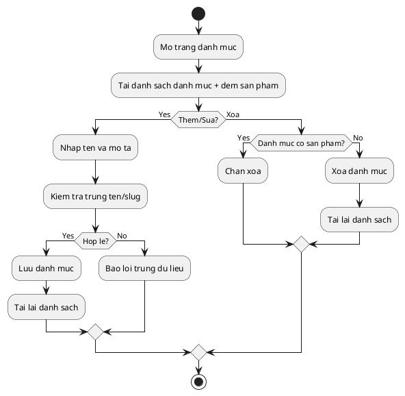

## 4. Quan ly san pham

Mo ta:

- Xem danh sach san pham co tim kiem, loc theo danh muc va phan trang.
- Them, sua, xoa san pham.
- Quan ly cac truong SKU, gia nhap, gia ban, ton kho, ton toi thieu, mo ta, hinh anh.
- Khong cho xoa san pham da co trong hoa don ban.
- Neu da tung xuat hien trong phieu nhap, he thong xoa cac dong nhap lien quan truoc khi xoa san pham.

PlantUML:

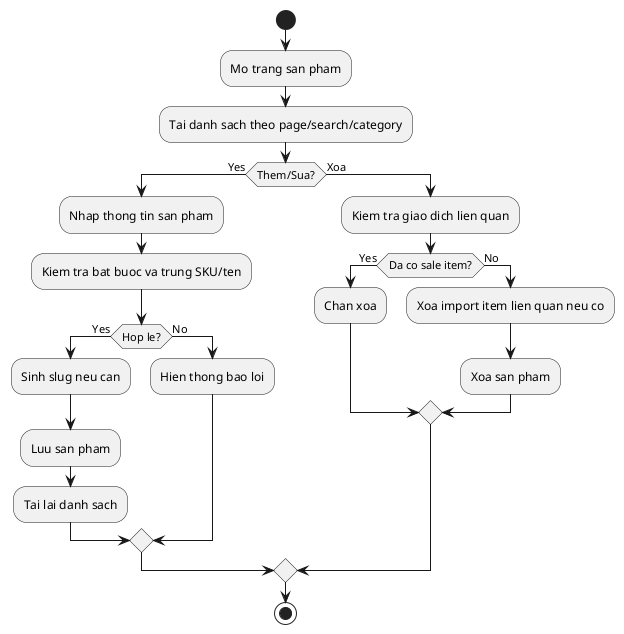

## 5. Quan ly don vi tinh

Mo ta:

- Quan ly bo don vi chung cua he thong.
- Danh dau don vi co ban va don vi quy doi.
- Tim kiem theo ten hoac viet tat.
- Khong cho xoa don vi dang duoc gan cho san pham.

PlantUML:

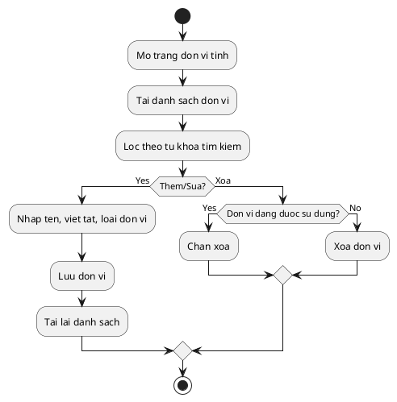

## 6. Quan ly don vi theo san pham

Mo ta:

- Moi san pham co the gan nhieu don vi ban khac nhau.
- **Don vi ban le mac dinh (`isDefault`)**: bat buoc co, luon co `conversionQty = 1`.
  Ton kho trong database duoc dem theo don vi nay.
- **Don vi goc nhap hang (`isPurchase`)**: don vi dung khi nhap hang tu nha cung cap
  (thung, loc...). Chi mot don vi goc cho moi san pham. Neu khong gan don vi goc
  rieng thi don vi ban le mac dinh dong vai tro goc.
- Moi don vi co `conversionQty`, `price` va co the dat lam `isDefault`.
- Khi dat mac dinh moi, he thong bo mac dinh cua don vi cu.
- Khong cho bo co "mac dinh" cua don vi mac dinh duy nhat cua san pham (HTTP 409).
- Khong cho xoa don vi mac dinh duy nhat cua san pham (HTTP 409).
- Khi tao hoac sua san pham (`/api/products`, `/api/v1/products`), client phai gui
  `defaultUnit` va `purchaseUnit`. Thieu `defaultUnit` se bi tu choi voi ma loi
  `UNIT_REQUIRED`.
- Dung trong man hinh POS de chon cach ban theo cai/lon/thung...

PlantUML:

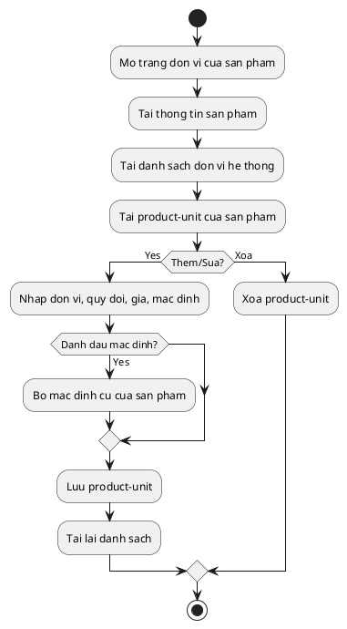

## 7. Quan ly nha cung cap

Mo ta:

- Xem, tim kiem, them, sua, xoa nha cung cap.
- Luu ten, so dien thoai, email, dia chi.
- Khong cho xoa nha cung cap da co phieu nhap.

PlantUML:

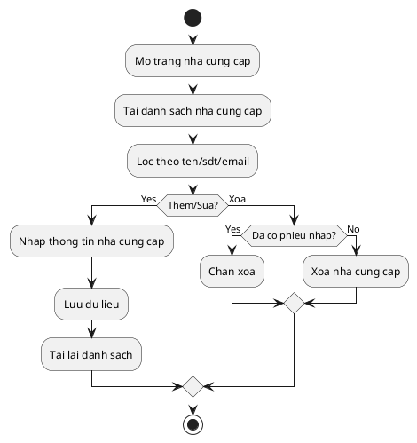

## 8. Quan ly khach hang

Mo ta:

- He thong co API lay danh sach khach hang dang hoat dong va tao khach hang moi.
- Hien tai giao dien rieng cho CRUD khach hang chua thay xuat hien trong `src/app`.
- Danh sach khach hang dang duoc dung o buoc thanh toan ban hang.

PlantUML:

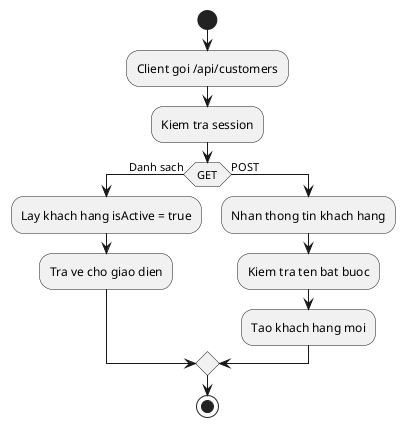

## 9. Nhap hang thu cong

Mo ta:

- Tao phieu nhap voi nha cung cap va danh sach mat hang.
- Cho phep chon san pham da co hoac nhap ten san pham moi.
- Neu san pham chua ton tai, he thong co the tu tao san pham moi voi SKU va slug tu sinh.
- Khi luu phieu nhap, ton kho tang len va gia nhap hien tai cua san pham duoc cap nhat.

PlantUML:

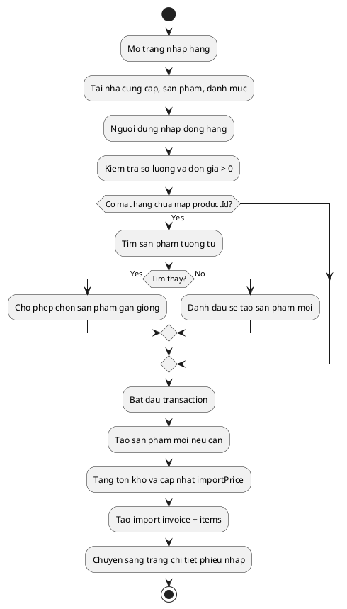

## 10. OCR hoa don nhap

Mo ta:

- Cho phep tai anh hoa don JPG/PNG/WebP toi da 10MB.
- Gui anh len OpenRouter de trich xuat danh sach san pham, so luong, don gia va danh muc goi y.
- Ket qua OCR duoc do vao form nhap hang.
- He thong co API test ket noi OpenRouter rieng.

PlantUML:

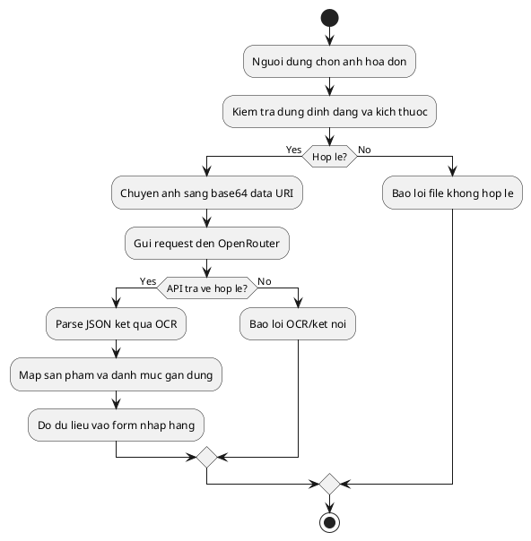

## 11. Lich su va chi tiet phieu nhap

Mo ta:

- Xem danh sach phieu nhap theo trang, tim kiem, loc theo trang thai.
- Xem chi tiet tung phieu nhap.
- Hien thay doi gia nhap neu gia moi khac gia cu.
- Cho phep huy phieu nhap; khi huy, he thong hoan tra ton kho.
- API xoa phieu nhap chi cho phep voi phieu `PENDING`.

PlantUML:

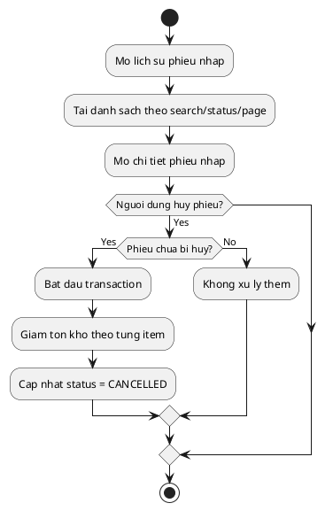

## 12. Ban hang POS

Mo ta:

- Tai danh sach san pham dang hoat dong va danh sach khach hang.
- Neu san pham co nhieu don vi, nguoi dung duoc chon don vi truoc khi them vao gio.
- Gio hang kiem soat so luong toi da theo ton kho va quy doi don vi.
- Thanh toan ho tro tien mat, chuyen khoan, the, vi dien tu.
- Khi hoan tat, he thong tao hoa don va tru ton kho trong transaction.

PlantUML:

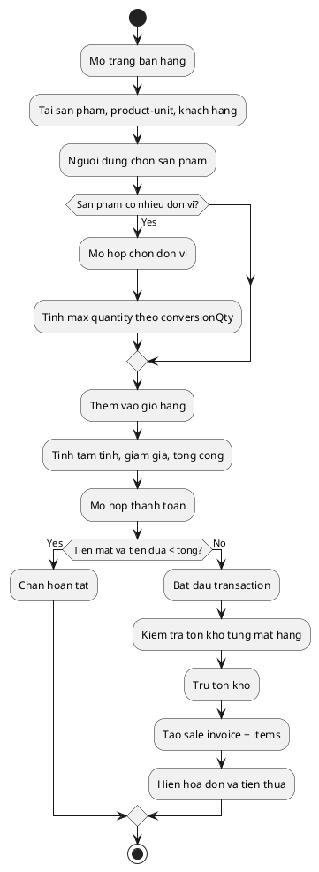

## 13. Quan ly ton kho

Mo ta:

- Hien ton kho hien tai cua san pham.
- Tim kiem, loc theo danh muc, loc theo trang thai con hang/sap het.
- Hien thong ke tong san pham, sap het, het hang, con hang.
- Nut xuat bao cao hien chi la UI, chua thay API xuat file thuc te.

PlantUML:

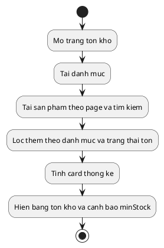

## 14. Thong ke doanh thu

Mo ta:

- Xem doanh thu tong hop theo nam, thang, ngay.
- Tinh tong doanh thu, gia von, loi nhuan, bien loi nhuan, so hoa don, tong so luong ban.
- Drill-down tu cot thang -> ngay -> chi tiet san pham ban trong ngay.
- Co endpoint bo sung `sales-stats` de tong hop nhanh so hoa don theo trang thai.

PlantUML:

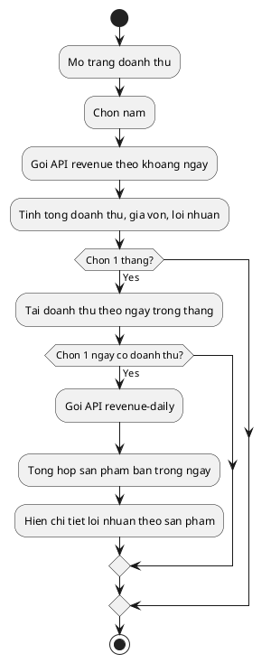

## 15. Tao du lieu doanh thu mau

Mo ta:

- API tao ngau nhien hoa don ban trong 7 ngay gan nhat de phuc vu demo trang doanh thu.
- Chon toi da 10 san pham con ton, tao nhieu hoa don mau, sau do tru ton kho tuong ung.
- Tinh nang nay phuc vu kiem thu/demo, khong phai luong van hanh chinh.

PlantUML:

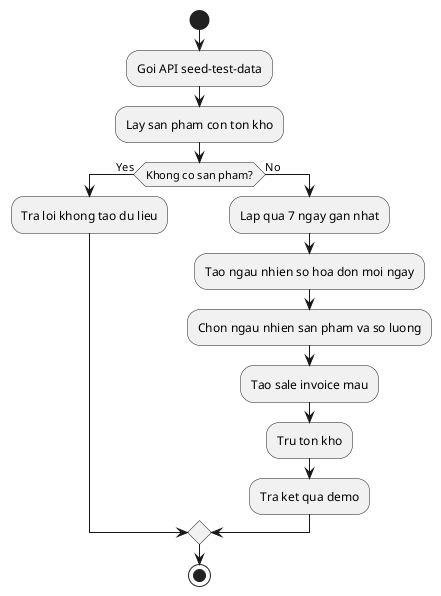

## 16. AI OCR test va cau hinh

Mo ta:

- Trang `/ai-ocr` gom 3 tab: thu nghiem OCR, kiem tra ket noi OpenRouter, va huong dan cau hinh.
- Cho phep chon model OCR truoc khi test.
- Kiem tra ket noi bang mot request nho toi OpenRouter.
- Day la cong cu van hanh/kiem thu, bo sung cho luong OCR trong nhap hang.

PlantUML:

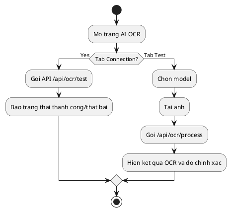

## 17. Cai dat he thong

Mo ta:

- Trang cai dat co cac tab Chung, AI OCR, Co so du lieu, Thong bao.
- Co bat/tat dark mode tren client.
- Nut luu hien tai chi mo phong trang thai dang luu, chua thay ket noi API/DB de luu thiet lap.
- Cac nut sao luu/khoi phuc/thong bao hien la UI placeholder.

PlantUML:

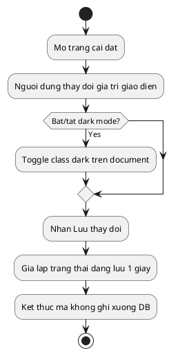

## Ghi chu tong ket

- He thong co nhieu nghiep vu chinh da hoat dong tot: dang nhap, san pham, danh muc, don vi, nha cung cap, nhap hang, ban hang, ton kho, doanh thu va OCR.
- Mot so thanh phan hien moi o muc ho tro hoac placeholder: trang cai dat, nut xuat bao cao ton kho, backup/restore, thong bao, in phieu.
- Quan ly khach hang hien ton tai o tang API va duoc tich hop vao thanh toan, nhung chua thay man hinh quan tri rieng.
